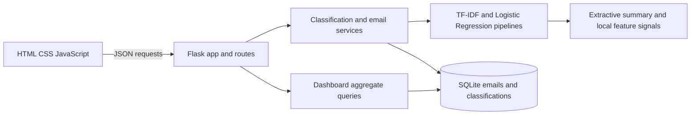

# Mail AI: Intelligent Business Email Classification

## 1. Introduction

Mail AI is a college capstone web application that classifies business email text and stores the resulting predictions in SQLite. It provides a Flask JSON API and a responsive browser dashboard for email triage and review.

## 2. Problem Statement

Teams that receive large volumes of email need to prioritize work and route messages efficiently. Manually sorting every message takes time and can delay responses. Security-related wording can also warrant review. Mail AI demonstrates how a small supervised model can help organize incoming messages, while leaving decisions to people.

## 3. Objectives

- Classify an email's business category, priority, and risk level.
- Save emails and versioned classification records in a local database.
- Expose classification, inbox, health, and dashboard functionality through JSON APIs.
- Present model scores and text signals as review aids, not verified facts.
- Keep training, inference, persistence, and HTTP routing in separate modules.

## 4. Features

- Live email classification with category, priority, risk, and category model score.
- Extractive summary made from the email's leading text; no generative model is used.
- Positive TF-IDF/logistic-regression feature signals for category and priority where the loaded model supports them.
- Pattern-based risk indicators, explicitly presented as human-review cues rather than proof of malicious intent.
- SQLite inbox with search, category/priority/risk/status filters, pagination, status updates, and deletion.
- Dashboard KPIs and Chart.js category, priority, and risk distributions based on stored classifications.
- Demo reset that atomically restores built-in sample records.
- Health endpoint that reports database and model availability.

## 5. Technology Stack

| Area | Technology |
|---|---|
| Backend | Python 3.10+, Flask |
| Machine learning | scikit-learn TF-IDF and Logistic Regression |
| Data preparation | pandas, NumPy |
| Model persistence | joblib |
| Database | SQLite 3 |
| Frontend | HTML, CSS, vanilla JavaScript, Chart.js |
| Tests / WSGI | pytest, Waitress |

## 6. System Architecture



The application factory is in `app.py`. Routes validate HTTP input, services coordinate classification and persistence, `models/` owns training and inference, and `database/db.py` owns SQLite schema and queries. The frontend is served from Flask's `templates/` and `static/` directories.

## 7. Machine Learning Methodology

`data/training_emails.csv` contains subject, body, category, priority, and risk-level columns. The trainer validates the data, combines subject and body, and uses a seeded train/test split stratified by category. Each target has its own scikit-learn Pipeline containing a TF-IDF vectorizer and Logistic Regression classifier. Pipelines are fitted on training data only and serialized in `models/email_model.joblib`.

Training reports accuracy, weighted precision, recall and F1, per-class reports, and confusion matrices. To make supported model signals visible, inference multiplies present TF-IDF values by positive Logistic Regression coefficients for the predicted class. These local signals indicate association with a model score, not causation.

Category probabilities are not calibrated confidence guarantees. The training set is small and class distributions are uneven, particularly for risk. Risk patterns are heuristics for human review and do not establish that a message is malicious.

## 8. Database Schema

The schema is created automatically when the Flask application starts. `database/db.py` also migrates the older denormalized `emails` table into the current schema. It does not invent or seed classification labels.

### `emails`

Contains `id`, `subject`, `body`, `sender`, `received_at`, and `created_at`, plus inbox metadata such as recipient, status, routing suggestion, SLA, and key phrases.

### `classifications`

Contains `id`, `email_id`, `category`, `priority`, `risk_level`, `confidence`, `model_version`, and `classified_at`, plus priority/risk scores. `email_id` references `emails.id` with `ON DELETE CASCADE`. A unique `(email_id, model_version)` constraint avoids accidental duplicate results for the same model version while retaining classifications from different versions.

All timestamps are stored as UTC ISO-8601 strings. User values are bound as SQL parameters.

## 9. Project Directory Structure

```text
mail-ai/
|-- app.py
|-- requirements.txt
|-- pytest.ini
|-- README.md
|-- data/
|   |-- training_emails.csv
|   `-- validate_dataset.py
|-- database/
|   `-- db.py
|-- models/
|   |-- email_classifier.py
|   |-- email_insights.py
|   |-- train_model.py
|   |-- email_model.joblib
|   `-- evaluation_results.json
|-- routes/
|   |-- dashboard_routes.py
|   `-- email_routes.py
|-- services/
|   |-- classification_service.py
|   |-- demo_data.py
|   `-- email_service.py
|-- static/
|   |-- css/styles.css
|   `-- js/script.js
|-- templates/index.html
`-- tests/
    |-- conftest.py
    |-- test_app.py
    |-- test_classification_service.py
    |-- test_database.py
    |-- test_email_insights.py
    `-- test_training.py
```

## 10. Installation Instructions

Use Python 3.10 or newer. From PowerShell:

```powershell
cd "C:\path\to\mail-ai"
py -3 -m venv .venv
.\.venv\Scripts\Activate.ps1
python -m pip install --upgrade pip
python -m pip install -r requirements.txt
```

On macOS/Linux, activate with `source .venv/bin/activate` instead. No API keys or external service credentials are required.

## 11. Dataset Preparation

The included `data/training_emails.csv` is the small curated sample dataset used by this project. Keep its header names and allowed labels consistent with `models/train_model.py`. Do not add real or confidential email content to a public repository without permission and appropriate anonymization.

Validate the included dataset from the project directory:

```powershell
python data/validate_dataset.py
```

Validation failures return a non-zero exit status. The trainer also drops blank email text and invalid labels, and fails clearly if the dataset is missing or has too few valid records.

## 12. Model Training Instructions

The repository includes a pre-trained `models/email_model.joblib` bundle so the app can run immediately. To retrain from the included dataset:

```powershell
python models/train_model.py
```

The command writes the model bundle and `models/evaluation_results.json`. Optional positional arguments select a dataset, model output, and evaluation output:

```powershell
python models/train_model.py data/training_emails.csv models/email_model.joblib models/evaluation_results.json
```

Training metrics describe a held-out split of this dataset; they are not a promise of future accuracy. The model bundle is about 0.90 MiB, so it is included for convenient college-project setup. It can be regenerated with the command above. Only load model bundles you trust because joblib uses Python serialization.

## 13. Database Initialization

The application calls `init_db()` on startup. That function creates/migrates the schema only. If the inbox is empty, the email service classifies the raw demo presets with the loaded model before storing them transactionally. On later startups, records marked as legacy migration/demo fixtures are retained as history and receive a current model-version result. Reset Demo follows the same model-backed path. To initialize the schema explicitly from the project directory:

```powershell
python -c "from database.db import init_db; init_db()"
```

The default file is `database/emails.db`. Set `MAIL_AI_DATABASE` to use a different SQLite file. Local databases are ignored by Git; pytest uses temporary databases.

## 14. Application Startup Instructions

Development:

```powershell
python app.py
```

Open `http://127.0.0.1:5000`. `PORT` and `HOST` can override the bind settings. For a local WSGI process on Windows:

```powershell
$env:APP_ENV = "production"
waitress-serve --host=127.0.0.1 --port=5000 app:app
```

Production mode keeps Flask debug disabled. For access beyond localhost, place a TLS reverse proxy in front and add an authentication/authorization layer first.

## 15. API Endpoint Documentation

All API request and response bodies use JSON unless noted.

| Method | Path | Behavior |
|---|---|---|
| `GET` | `/api/health` | Returns app, model, and database availability; 503 when a dependency is unavailable. `/health` is an alias. |
| `POST` | `/api/emails/classify` | Classifies and saves an email; returns 201 and the saved email plus classification. |
| `POST` | `/api/emails` | Same classify-and-save workflow. |
| `GET` | `/api/emails` | Lists emails. Supports `search`, `category`, `priority` or `urgency`, `risk_level`, `status`, `limit` (1-100), and `offset`. |
| `GET` | `/api/emails/<id>` | Returns a saved email with its latest classification and model details. |
| `PATCH` | `/api/emails/<id>/status` | Sets a supported inbox status. JSON: `{"status":"Resolved"}`. |
| `DELETE` | `/api/emails/<id>` | Deletes the email and cascades to its classification records. |
| `POST` | `/api/emails/batch-classify` | Classifies up to 100 validated emails without saving them. |
| `GET` | `/api/dashboard/stats` | Returns database-backed KPI and category/priority/risk aggregates. |
| `GET` | `/api/dashboard/presets` | Returns built-in sample email scenarios. |
| `POST` | `/api/dashboard/reset-demo` | Atomically replaces inbox data with built-in demo records. |

Email input limits: subject 500 characters, body 50,000, sender/recipient 320 each. The Flask request body limit is 2 MiB. The classify endpoints require at least a non-empty subject or body; the browser form asks for both.

## 16. Testing Instructions

Install the declared development/test dependencies with the normal requirements command, then run from the project directory:

```powershell
python -m pytest -q
```

The pytest fixture sets `MAIL_AI_DATABASE` to a temporary file before importing the application. Training tests save the model and evaluation report under pytest temporary storage. They do not overwrite `database/emails.db`, `models/email_model.joblib`, or the checked-in evaluation report.

## 17. Current Limitations

- This is an educational prototype, not a production-secure or independently audited system.
- There is no authentication or authorization. Keep the service on localhost or a trusted private network.
- SQLite content is stored unencrypted. Apply file permissions, backups, and retention controls appropriate to your data.
- The sample dataset is small and imbalanced. In the current evaluation, risk-class recall is weak; do not use the model as the sole basis for security or financial decisions.
- Logistic Regression probability outputs are not calibrated confidence guarantees.
- Keyword/pattern risk indicators can produce false positives and do not prove malicious intent.
- The application logs exception types but has no centralized monitoring, rate limiting, or user-level audit trail.
- Same-origin browser/API requests are used; CORS is not configured or needed for this setup.

## 18. Future Scope

- Expand and independently review the dataset; measure per-class precision/recall over repeatable splits.
- Add authentication, authorization, rate limiting, and audit-safe monitoring before remote deployment.
- Add configurable retention, encrypted storage/backups, and privacy controls.
- Evaluate calibrated probabilities and drift monitoring.
- Add an optional, separately evaluated summarization/explanation model behind a replaceable interface.
- Improve model evaluation with cross-validation and a maintained benchmark set.

## 19. GitHub Submission Commands

First review the files to be staged. From the `mail-ai` directory:

```powershell
git init
git branch -M main
git add -A
git status --short
git diff --cached --stat
git commit -m "Prepare Mail AI for college submission"
```

Then inspect remotes before connecting GitHub:

```powershell
git remote -v
```

If no remote is configured, add your repository URL and push:

```powershell
git remote add origin https://github.com/<OWNER>/<REPOSITORY>.git
git remote -v
git push -u origin main
```

If `origin` already exists, inspect `git remote get-url origin` and confirm it is the intended repository. Do not run `git remote add origin` again or replace the URL unless you have verified and intentionally chosen to change it. Never put credentials, tokens, `.env` files, local databases, virtual environments, caches, or private/generated email data in the commit. The small pre-trained model bundle is included; regenerate it with the training command if it is removed.